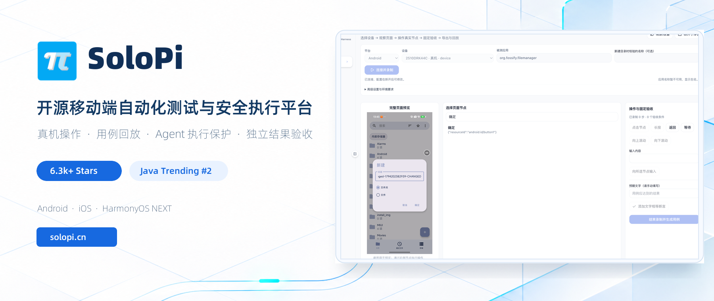
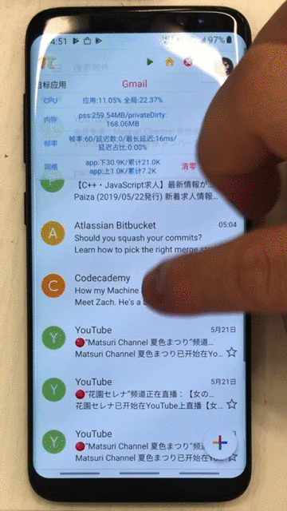

<p align="center">
  <a href="https://www.solopi.cn/">官方网站</a> ·
  <a href="https://github.com/alipay/SoloPi/releases/latest">下载 APK</a> ·
  <a href="#快速开始">快速开始</a> ·
  <a href="README_eng.md">English</a>
</p>

<p align="center">
  <a href="https://github.com/alipay/SoloPi"></a>
  <a href="https://github.com/alipay/SoloPi/releases/latest"></a>
  <a href="LICENSE"></a>
</p>

SoloPi 将 Android 录制回放、跨平台桌面控制和面向 AI Agent 的 Skill / Harness 放在同一条测试链路中。被测应用通常无需接入 SDK；每次任务都可以保留页面观察、动作回执和结果证据。

> 6.3k+ GitHub Stars · [历史 Java Trending 日榜最高第 2，曾连续 6 天上榜](https://github.com/frodeaa/github_trending_archive/tree/master/archive/2019-07)

## 三种使用方式

| | Desktop | Skill / Harness | Android App |
| --- | --- | --- | --- |
| **适合** | 图形化设备操作与用例管理 | Agent、CLI 与自动化集成 | 手机端录制回放与性能诊断 |
| **能力** | 页面检查、节点选择、录制、回放、报告 | 动作约束、执行复核、固定验收、结构化产物 | 设备执行、性能采集、经典自动化工具 |
| **入口** | [`solopi-desktop/`](solopi-desktop/README.md) | [`solopi-skill/`](solopi-skill/SKILL.md) | [`solopi-app/`](solopi-app/README.md) |

三者可以独立使用，也可以组合成完整链路：Desktop 提供工作台，Skill 约束 Agent 的使用方式，Harness 负责任务编排与验收，Android App 在设备侧采集和执行。

## 为什么使用 SoloPi

- **真实设备，低接入成本**：直接观察和操作移动应用，目标应用通常无需集成 SoloPi SDK。
- **从录制到复现**：记录页面节点、操作和检查条件，用固定用例重复验证真实流程。
- **让 Agent 在边界内执行**：提交动作前复核当前页面和目标，页面变化时避免继续执行已经失效的旧动作。
- **完成动作不等于测试通过**：使用预先定义的检查点读取业务状态，独立给出 `passed`、`failed` 或 `not_tested`。
- **证据随运行保存**：保留截图、日志、动作回执和结构化报告，便于定位与复核。

## 快速开始

### 1. 查看内置工作流

在仓库根目录运行。这个命令不需要连接设备，也不会操作应用：

```bash
./solopi-skill/scripts/solopi-ai --pretty workflow-list
```

### 2. 检查 Android 设备

设备已开启 USB 调试并完成授权后：

```bash
adb devices -l

./solopi-skill/scripts/solopi-ai \
  --serial <设备序列号> \
  --pretty doctor
```

### 3. 启动 Desktop

需要 Node.js、npm、Python 3.9+ 和相应平台的设备工具。Desktop 文档使用 Node.js 22.14.0 验证。

```bash
cd solopi-desktop
npm ci
npm run dev
```

首次连接、录制与回放步骤见 [Desktop 使用说明](solopi-desktop/README.md)和[三端设备控制指南](solopi-desktop/docs/THREE_PLATFORM_CONTROL.md)。

### 4. 运行一个准备好的工作流

仓库提供需要特定应用、账号和初始页面的只读示例。确认环境符合模板要求后运行：

```bash
./solopi-skill/scripts/solopi-ai \
  --serial <设备序列号> \
  --pretty workflow-run \
  --template alipay-more-services
```

运行结束后，根据输出中的 `artifacts` 查看本次运行报告。模板不是通用冒烟用例；应用版本、账号状态或初始页面不符合要求时，应先调整环境或编写自己的用例。

## 工作方式

```text
Desktop / Agent / CLI
          │
          ▼
  Skill + Harness
  计划、会话、动作约束与证据
          │
          ▼
Android SoloPi / iOS WDA / NEXT 驱动
          │
          ▼
观察页面 → 提交前复核 → 执行动作
          │
          ▼
固定检查点 → 独立结果判定
```

Harness 把“动作是否执行”和“业务是否正确”分开处理：

- `passed`：必需检查点和清理条件通过。
- `failed`：已确认结果不符合预期。
- `not_tested`：证据不足，无法可靠判定。

动作结果不确定时，请先检查执行记录和设备状态，再决定是否重试。测试结果由检查点及其证据判定。

## 平台与成熟度

| 能力 | 状态 | 当前范围 |
| --- | --- | --- |
| Android App 录制回放与性能工具 | **核心能力** | 支持范围取决于系统、设备、目标应用和权限 |
| Desktop 控制 Android | **Beta** | 已验证页面检查、录制回放及特定真实 App 流程 |
| Skill / Harness 安全执行 | **Beta** | 已验证受控任务中的动作复核、固定验收与证据产物 |
| iOS / WebDriverAgent | **实验能力** | 已验证原生测试应用与特定真实 App 只读流程 |
| HarmonyOS NEXT / HDC | **实验能力** | 当前以模拟器上的受控原生应用流程为限 |
| 后台屏幕、Laya、视觉辅助与消息自动回复 | **研究原型** | 默认关闭或需要额外环境，使用前请查阅对应模块的配置说明 |

三端共用部分控制入口和结果语义，具体功能支持因平台而异。Android 性能插件、录屏等能力的支持范围，请以各平台文档为准。

Harness 的拦截效果取决于动作约束、页面信息和运行环境，接入新场景时需验证。配置前提与限制见[三端设备控制指南](solopi-desktop/docs/THREE_PLATFORM_CONTROL.md)和[原生回归指南](solopi-skill/references/native-regression-guide.md)。

## Android 经典功能

### 录制回放


### 性能工具



## 构建与测试

构建 Android 调试包：

```bash
./solopi-app/gradlew -p solopi-app :portal:assembleDebug
adb install -r solopi-app/portal/build/outputs/apk/debug/portal-debug.apk
```

运行 Harness 单元测试：

```bash
python3 -m unittest discover -s solopi-skill/scripts/harness/tests -v
```

若设备上已有不同签名的 SoloPi，覆盖安装会失败。首次启动和辅助功能等系统授权需要在设备上完成。Android 单元测试、Desktop 打包及更多开发命令见各模块 README。

## 文档

- [Android 使用与功能说明](solopi-app/README.md)
- [Desktop 使用说明](solopi-desktop/README.md)
- [三端设备控制](solopi-desktop/docs/THREE_PLATFORM_CONTROL.md)
- [Skill 与 Harness](solopi-skill/SKILL.md)
- [内置工作流](solopi-skill/references/workflows.md)
- [验证计划与结果判定](solopi-skill/references/verification-engine.md)
- [托管执行与设备池](solopi-skill/references/managed-execution.md)
- [故障处理](solopi-skill/references/troubleshooting.md)

## 社区与贡献

欢迎通过 [Issue](https://github.com/alipay/SoloPi/issues)、Pull Request 或 [TesterHome SoloPi 板块](https://testerhome.com/topics/node152)讨论问题与改进。提交前请阅读[贡献指南](CONTRIBUTING.md)。

| 钉钉交流群 | 微信交流群 |
| --- | --- |
|  |  |

## 许可与使用边界

涉及设备、账号、图片或日志时，请使用经授权的测试环境；分享报告前检查个人信息。启用外部模型或上传图片前，请确认发送范围和被测数据适合共享。

SoloPi 以 [Apache License 2.0](LICENSE) 开源；第三方组件及素材适用各自许可证，详见 [NOTICE](NOTICE.md)。使用前请阅读[免责声明](Disclaimer.md)。
