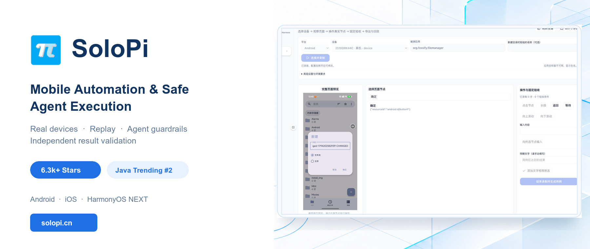
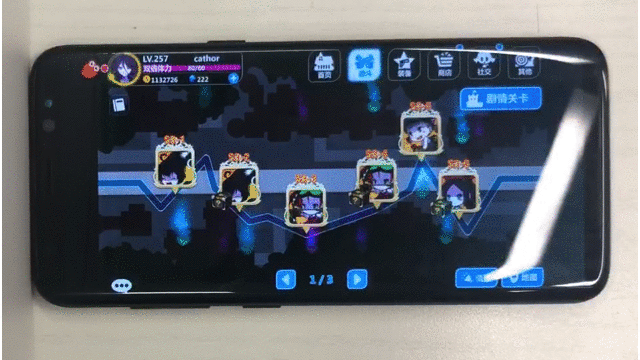
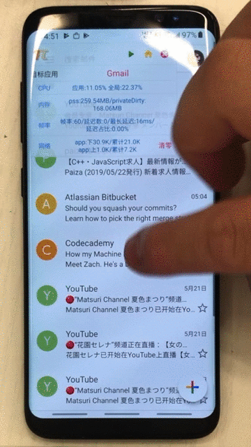
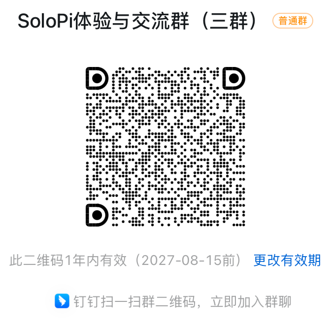

<p align="center">
  <a href="https://www.solopi.cn/">Website</a> ·
  <a href="https://github.com/alipay/SoloPi/releases/latest">Download APK</a> ·
  <a href="#quick-start">Quick Start</a> ·
  <a href="README.md">中文</a>
</p>

<p align="center">
  <a href="https://github.com/alipay/SoloPi"></a>
  <a href="https://github.com/alipay/SoloPi/releases/latest"></a>
  <a href="LICENSE"></a>
</p>

SoloPi brings Android record and replay, cross-platform desktop control, and a Skill / Harness for AI Agents into one testing workflow. The app under test normally does not need to integrate a SoloPi SDK, and every run can retain page observations, action receipts, and result evidence.

> 6.3k+ GitHub Stars · [Java Trending daily peak: #2, with six consecutive days on the list](https://github.com/frodeaa/github_trending_archive/tree/master/archive/2019-07)

## Three Ways to Use SoloPi

| | Desktop | Skill / Harness | Android App |
| --- | --- | --- | --- |
| **Best for** | Visual device operation and case management | Agent, CLI, and automation integration | On-device record/replay and performance diagnosis |
| **Capabilities** | Page inspection, node selection, recording, replay, and reports | Action constraints, execution rechecks, fixed acceptance, and structured artifacts | Device execution, performance collection, and classic automation tools |
| **Start here** | [`solopi-desktop/`](solopi-desktop/README.md) | [`solopi-skill/`](solopi-skill/SKILL.md) | [`solopi-app/`](solopi-app/README_eng.md) |

Each component can be used independently or as part of a complete workflow. Desktop provides the workbench, the Skill defines how an Agent should use SoloPi, the Harness orchestrates tasks and acceptance, and the Android App observes and acts on the device.

## Why SoloPi

- **Real devices with low integration cost:** Observe and operate mobile apps directly; the target app normally does not need the SoloPi SDK.
- **From recording to reproduction:** Capture page nodes, actions, and checks, then repeat a fixed case on a real device.
- **Keep Agents inside action boundaries:** Recheck the current page and target before execution so a stale action is not sent after the page changes.
- **An executed action is not automatically a passed test:** Read business state through predefined checkpoints and independently return `passed`, `failed`, or `not_tested`.
- **Evidence retained with each run:** Keep screenshots, logs, action receipts, and structured reports for diagnosis and review.

## Quick Start

### 1. List Built-in Workflows

Run from the repository root. This command does not connect to or operate a device:

```bash
./solopi-skill/scripts/solopi-ai --pretty workflow-list
```

### 2. Check an Android Device

After USB debugging is enabled and the computer is authorized:

```bash
adb devices -l

./solopi-skill/scripts/solopi-ai \
  --serial <device-serial> \
  --pretty doctor
```

### 3. Start Desktop

Node.js, npm, Python 3.9+, and platform-specific device tools are required. The Desktop documentation is verified with Node.js 22.14.0.

```bash
cd solopi-desktop
npm ci
npm run dev
```

See the [Desktop guide](solopi-desktop/README.md) and [three-platform device-control guide](solopi-desktop/docs/THREE_PLATFORM_CONTROL.md) for connection, recording, and replay steps.

### 4. Run a Prepared Workflow

The repository includes read-only examples that require a specific app, account, and initial page. Confirm that the environment matches the template before running:

```bash
./solopi-skill/scripts/solopi-ai \
  --serial <device-serial> \
  --pretty workflow-run \
  --template alipay-more-services
```

After the run, inspect the path returned in `artifacts`. Templates are not universal smoke tests. Adjust the environment or write a dedicated case when the app version, account state, or initial page differs.

## How It Works

```text
Desktop / Agent / CLI
          |
          v
  Skill + Harness
  Plan, session, action constraints, and evidence
          |
          v
Android SoloPi / iOS WDA / NEXT driver
          |
          v
Observe -> pre-action recheck -> execute
          |
          v
Fixed checkpoints -> independent result judge
```

The Harness separates action execution from business correctness:

- `passed`: all required checkpoints and cleanup conditions succeeded.
- `failed`: the confirmed outcome did not meet the expectation.
- `not_tested`: the available evidence is insufficient for a reliable result.

An action with an unknown outcome must not be retried blindly. An Agent's completion claim does not directly mean that the test passed.

## Platforms and Maturity

| Capability | Status | Current scope |
| --- | --- | --- |
| Android App record/replay and performance tools | **Core** | Support varies by OS, device, target app, and permissions |
| Desktop control for Android | **Beta** | Page inspection, record/replay, and selected real-app workflows have been verified |
| Skill / Harness safe execution | **Beta** | Action rechecks, fixed acceptance, and evidence artifacts have been verified in controlled tasks |
| iOS / WebDriverAgent | **Experimental** | Native test apps and selected read-only real-app workflows have been verified |
| HarmonyOS NEXT / HDC | **Experimental** | Current evidence is limited to controlled native-app workflows on an emulator |
| Background display, Laya, visual assistance, and message auto-reply | **Research prototypes** | Disabled by default or dependent on additional setup; not presented as generally stable capabilities |

The platforms share selected control entry points and result semantics. This does **not** mean that Android performance plugins, screen recording, or every device capability are available on iOS or NEXT. SoloPi also does not claim zero missed blocks or zero false blocks across arbitrary apps, devices, and models. See the [three-platform guide](solopi-desktop/docs/THREE_PLATFORM_CONTROL.md) and [native regression guide](solopi-skill/references/native-regression-guide.md) for prerequisites and limitations.

## Classic Android Features

### Record and Replay



### Performance Tools



The original project introduced OneToMany device control, but that feature remains **closed source** because of stability concerns and is not available from the current repository.

## Build and Test

Build the Android debug APK:

```bash
./solopi-app/gradlew -p solopi-app :portal:assembleDebug
adb install -r solopi-app/portal/build/outputs/apk/debug/portal-debug.apk
```

Run Harness unit tests:

```bash
python3 -m unittest discover -s solopi-skill/scripts/harness/tests -v
```

An existing SoloPi installation with a different signature cannot be overwritten. Android permissions, including accessibility, must be completed on the device. See the module READMEs for Android unit tests, Desktop packaging, and additional development commands.

## Documentation

- [Android usage and features](solopi-app/README_eng.md)
- [Desktop workbench](solopi-desktop/README.md)
- [Three-platform device control](solopi-desktop/docs/THREE_PLATFORM_CONTROL.md)
- [Skill and Harness](solopi-skill/SKILL.md)
- [Built-in workflows](solopi-skill/references/workflows.md)
- [Verification plans and result adjudication](solopi-skill/references/verification-engine.md)
- [Managed execution and device pools](solopi-skill/references/managed-execution.md)
- [Troubleshooting](solopi-skill/references/troubleshooting.md)

## Community and Contributing

Use [Issues](https://github.com/alipay/SoloPi/issues), pull requests, or the [SoloPi board on TesterHome](https://testerhome.com/topics/node152) to discuss problems and improvements. Read the [contribution guide](CONTRIBUTING.md) before submitting a change.

| DingTalk | WeChat |
| --- | --- |
|  |  |

## License and Usage Boundary

Use authorized test environments for devices, accounts, images, and logs. Review personal information before sharing reports. Before enabling an external model or uploading an image, confirm that the destination and data-sharing boundary are appropriate.

SoloPi is available under the [Apache License 2.0](LICENSE). Third-party components and assets retain their own licenses and attribution requirements; see [NOTICE](NOTICE.md). Read the [Disclaimer](Disclaimer.md) before use.
